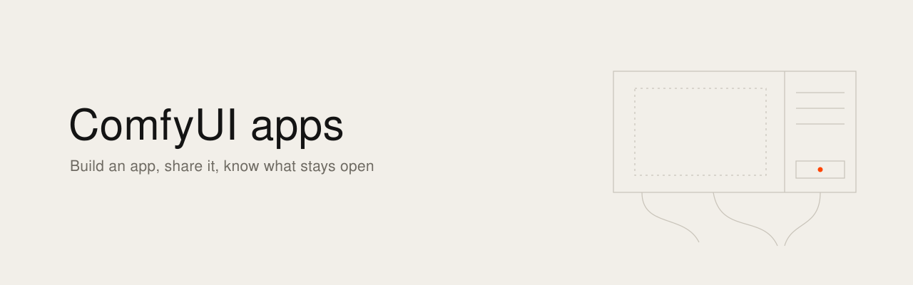

[English](README.md) · [Français](README.fr.md)

<picture><source media="(prefers-color-scheme: dark)" srcset="banner.svg"></picture>

# Les apps ComfyUI : les construire, les partager

J'ai essayé le mode App de ComfyUI sur ma RTX 5090 le 7 novembre 2026, avec ComfyUI 0.42 et le frontend 1.57.1. Le graphe disparaît, les entrées que j'ai choisies sont à droite, la sortie au centre, et l'image est sortie en 17 secondes. Donc la question d'après est très simple : comment je donne ça à quelqu'un ? Le blog officiel dit que les liens de partage marchent sur Cloud et en local. La documentation officielle dit Cloud seulement. Je suis cinéaste, j'ai lu le code pour savoir qui a raison, et cette note rassemble ce que j'ai trouvé. Chaque affirmation a son URL, pour que vous puissiez vérifier.

## En bref

- Le mode App change l'écran. Il n'ajoute ni connexion, ni utilisateurs, ni droits. Toute personne qui atteint votre ComfyUI peut y lancer n'importe quel workflow, app ou pas.
- Sur une installation locale, il n'y a pas de bouton Partager. On partage un fichier, et l'autre a besoin de ComfyUI, d'une carte graphique, des modèles et des nœuds.
- Le lien qui ne demande aucune installation existe seulement sur Comfy Cloud.
- Des amis avec une carte : envoyer le fichier. Des amis sans carte : Tailscale, et seulement des gens à qui vous donneriez un compte sur votre machine. Une équipe de film : un serveur privé avec un jeton devant. Le public : un point d'accès hébergé derrière votre propre site, jamais votre propre ComfyUI.

## Ce qu'est le mode App

[L'annonce](https://blog.comfy.org/p/from-workflow-to-app-introducing) (10 mars 2026) le décrit comme une nouvelle façon de voir et de lancer n'importe quel workflow : on choisit quelles entrées et quelles sorties de nœuds deviennent l'app. Il tourne, je traduis, sur la même instance, le même serveur, la même file d'attente. Le workflow reste le même. Seul l'écran change.

L'app n'est pas un format à part. C'est votre workflow avec deux champs de plus : [`extra.linearMode`](https://github.com/Comfy-Org/ComfyUI_frontend/blob/v1.57.1/src/platform/workflow/management/stores/comfyWorkflow.ts) dit s'il s'ouvre en app, et [`extra.linearData`](https://github.com/Comfy-Org/ComfyUI_frontend/blob/v1.57.1/src/stores/appModeStore.ts) liste les entrées et les sorties.

## Versions

[La documentation](https://docs.comfy.org/interface/app-mode) annonce un support officiel à partir du frontend 1.41.13. Avant, c'est une phase de test.

Lisez la version du frontend dans l'interface, sans la déduire de celle de ComfyUI. [ComfyUI 0.42.1 épingle le frontend 1.55.18](https://github.com/Comfy-Org/ComfyUI/blob/v0.42.1/requirements.txt), [0.43.0 épingle 1.57.4](https://github.com/Comfy-Org/ComfyUI/blob/v0.43.0/requirements.txt) et [0.44.0 épingle 1.57.6](https://github.com/Comfy-Org/ComfyUI/blob/v0.44.0/requirements.txt).

## Construire une app, étape par étape

Ces étapes suivent [la documentation](https://docs.comfy.org/interface/app-mode).

1. Ouvrez un workflow qui tourne déjà. Utilisez le menu en haut à gauche, ou le fil d'Ariane, et choisissez « Enter app mode ». Un workflow sans app ouvre le constructeur.
2. **Entrées.** Cliquez sur les nœuds surlignés pour en faire des entrées : un chargement d'image, un prompt, un choix de modèle. Ils apparaissent dans le panneau de droite.
3. **Sorties.** Choisissez les nœuds de sortie à montrer, par exemple Preview ou Save Image.
4. **Aperçu.** Vérifiez la disposition : entrées à droite, sorties dans le canevas. Back permet de revenir.
5. **Vue par défaut.** Choisissez si le workflow s'ouvre en app ou en graphe, puis Apply, puis View app.
6. Enregistrez avec Ctrl+S, ou Cmd+S sur Mac. Depuis le constructeur, le fichier prend le suffixe [`.app.json`](https://github.com/Comfy-Org/ComfyUI_frontend/blob/v1.57.1/packages/shared-frontend-utils/src/formatUtil.ts).

Trois choses que le test m'a apprises :

- Le panneau Apps n'affiche que les fichiers `.app.json`. Mon premier enregistrement, en `.json`, n'y apparaissait pas.
- Le raccourci pour passer du graphe à l'app est Option+M sur Mac, Alt+M ailleurs ([commande `Comfy.ToggleLinear`](https://github.com/Comfy-Org/ComfyUI_frontend/blob/v1.57.1/src/platform/keybindings/defaults.ts)). Il reste utile quand une barre d'extension recouvre le bouton de bascule, ce qui m'est arrivé.
- Un fichier s'ouvre directement en app si `extra.linearMode` vaut `true`.

La documentation précise aussi que la disposition s'adapte aux téléphones et aux écrans étroits, avec des onglets pour les entrées, les sorties et les fichiers.

## Partager : le fichier, le lien, le point d'accès

On mélange souvent trois choses différentes.

**Le fichier.** C'est la voie locale. L'application le dit elle-même, je traduis : [exportez-le depuis le menu de l'onglet, et quand d'autres l'ouvrent, ils voient le mode App](https://github.com/Comfy-Org/ComfyUI_frontend/blob/v1.57.1/src/locales/en/main.json). Clic droit sur l'onglet, Export. Le fichier emporte les valeurs de vos champs, donc vos prompts par défaut et les noms de fichiers de vos modèles. Il n'emporte ni les poids ni les nœuds : joignez-y une liste. Prenez l'Export normal : [Export (API) écrit `p.output`](https://github.com/Comfy-Org/ComfyUI_frontend/blob/v1.57.1/src/platform/workflow/core/services/workflowService.ts), et les champs de l'app vivent dans `p.workflow`.

**Le lien.** [La documentation](https://docs.comfy.org/interface/app-mode) le réserve à Comfy Cloud. [Le blog](https://blog.comfy.org/p/from-workflow-to-app-introducing) annonce le partage par URL sur Cloud et en local. Le code donne raison à la documentation. Dans le frontend 1.57.1, [l'entrée de menu](https://github.com/Comfy-Org/ComfyUI_frontend/blob/v1.57.1/src/composables/useWorkflowActionsMenu.ts) porte `visible: isCloud` et [le bouton de la barre du haut](https://github.com/Comfy-Org/ComfyUI_frontend/blob/v1.57.1/src/components/TopMenuSection.vue) porte `v-if="isCloud"`. [`isCloud`](https://github.com/Comfy-Org/ComfyUI_frontend/blob/v1.57.1/src/platform/distribution/types.ts) est fixé à la compilation du frontend. [Un commit du 7 octobre 2026](https://github.com/Comfy-Org/ComfyUI_frontend/commit/c64072bb6) l'écrit : l'interface de partage dépend désormais de `isCloud` seul.

La documentation dit que toute la configuration est dans le lien. Dans le code, le lien est [`?share=<id>`](https://github.com/Comfy-Org/ComfyUI_frontend/blob/v1.57.1/src/platform/workflow/sharing/services/workflowShareService.ts), donc une copie publiée vit sur les serveurs de Comfy. Le dialogue vous prévient que [les médias du workflow partent avec lui](https://github.com/Comfy-Org/ComfyUI_frontend/blob/v1.57.1/src/locales/en/main.json).

**Le point d'accès.** « Deploy to Comfy API » est dans le menu de l'onglet, y compris en local. [La documentation](https://docs.comfy.org/development/deploy/overview) dit que la carte renvoie vers platform.comfy.org. Là, [un Build fige la version de ComfyUI, les nœuds, les modèles et les dépendances Python](https://blog.comfy.org/p/comfy-api-is-live-deploy-comfyui), et on le déploie en point d'accès qui s'adapte à la charge. Ensuite on écrit son propre front, ou on prend celui de quelqu'un d'autre.

## Quoi pour qui

**Des amis.** S'ils ont une carte, envoyez le fichier et la liste des modèles et des nœuds. S'ils n'en ont pas, vous pouvez [partager votre machine par Tailscale](https://tailscale.com/docs/features/sharing) : ils voient cette machine et rien d'autre sur votre réseau, et il leur faut un compte Tailscale. Laissez ComfyUI sur `127.0.0.1` et mettez [Tailscale Serve](https://tailscale.com/docs/features/tailscale-serve) devant. Je le ferais seulement pour des gens à qui je donnerais un compte sur la machine, pour les raisons de la section sécurité. Pour des amis moins proches, [SwarmUI](https://github.com/mcmonkeyprojects/SwarmUI/blob/master/docs/Sharing%20Your%20Swarm.md) a de vrais comptes et cache les workflows bruts aux utilisateurs par défaut. C'est une autre interface que le mode App, et son auteur la valide pour les amis et la famille seulement.

**Une équipe de film.** Pour une matière qui reste privée, je pense au montage suivant : une machine dédiée sur un réseau privé, ComfyUI sur `127.0.0.1`, [comfy-api-proxy](https://docs.comfy.org/development/comfyui-server/api-proxy.md) avec un jeton devant, et les fichiers d'app dans un dépôt privé avec leur liste de modèles. L'offre gratuite de Tailscale est [réservée à l'usage non commercial](https://tailscale.com/pricing), donc une production prend une offre payante. Il reste une seule file : les gens s'attendent les uns les autres, et [`/interrupt` ne contrôle aucune identité](https://github.com/Comfy-Org/ComfyUI/blob/v0.44.0/server.py). Je n'ai pas encore fait tourner ce montage avec une équipe. Si la matière n'est pas sensible, [Comfy Cloud Team](https://comfy.org/pricing) propose des crédits partagés et des rôles.

**Le public.** Jamais votre propre ComfyUI. Un point d'accès hébergé derrière votre propre site, et votre site porte les comptes, les quotas et le plafond de dépense. À 3,49 $ de l'heure, une minute de GPU coûte environ 0,06 $, sans compter les démarrages à froid et le stockage. Comfy a [suspendu la création de comptes gratuits en mai 2026](https://x.com/ComfyUI/status/2053913932738507171) après un abus sur des modèles vidéo chers : le risque existe aussi pour eux. Vérifiez la licence de chaque modèle : [MiniMax H3 en local pour un usage commercial démarre à 5 000 $ par mois](https://comfy.org/pricing).

## Les options, avec les coûts

Lu le 7 novembre 2026. Les prix bougent.

| Option | Coût | Licence | Ce qui quitte votre machine |
|---|---|---|---|
| Fichier d'app | Gratuit | [ComfyUI, GPL-3.0](https://github.com/Comfy-Org/ComfyUI) | Le fichier, à qui vous l'envoyez |
| [Lien Comfy Cloud](https://docs.comfy.org/interface/app-mode) | [À partir de 20 $ par mois, Team à partir de 200 $](https://comfy.org/pricing) | Service | Workflow et médias |
| [ComfyHub](https://comfy.org/hub/apps/) | Aucun prix trouvé | Service | Tout, en public. [Accès sélectif en mars](https://www.reddit.com/r/comfyui/comments/1rq3o5u/comfyui_launches_app_mode_and_comfyhub) |
| [Comfy API](https://comfy.org/platform/comfy-api.md) | Offre payante, plus 3,49 $/h sur RTX PRO 6000, 0,20 $/Go/mois | Service | Workflow, nœuds, modèles, puis les entrées et sorties de vos utilisateurs |
| [ViewComfy](https://www.viewcomfy.com/pricing) | 0 $ plus le calcul, Team 30 $, Studio 200 $ | [Code AGPL-3.0](https://github.com/ViewComfy/ViewComfy) | Sur leur cloud, tout. Auto-hébergé, selon votre serveur |
| [ComfyDeploy](https://www.comfydeploy.com/comfyui-playground) | Non vérifié | [Code AGPL-3.0](https://github.com/BennyKok/comfyui-deploy) | Sur leur cloud, tout |
| [RunComfy](https://www.runcomfy.com/) | Non vérifié | Service | Workflow, nœuds, modèles référencés |
| [SwarmUI](https://swarmui.net/) | Gratuit | MIT | Rien |
| [ComfyUI avec Tailscale](https://tailscale.com/pricing) | Gratuit jusqu'à 6 personnes, non commercial. Standard 8 $ par personne et par mois | | Les métadonnées de connexion |

[Comfy Registry](https://support.comfy.org/articles/1674221690-comfy-apis-an-overview) publie des nœuds. Il ne publie pas d'apps.

J'ai cherché comment les studios partagent leurs apps en interne, et je n'ai trouvé aucun témoignage de première main. Ce qui existe vient des vendeurs : [Silverside qui sert ses clients par Comfy API](https://blog.comfy.org/p/comfy-api-is-live-deploy-comfyui), cité par Comfy, et [Comfy Enterprise](https://comfy.org/enterprise). Si vous faites ça dans un studio, ça m'intéresse de savoir comment.

## Sécurité

**ComfyUI n'a pas d'authentification.** [La documentation](https://docs.comfy.org/development/deploy/self-hosting.md) le dit : le serveur n'a pas d'authentification par défaut. [La politique de sécurité](https://github.com/Comfy-Org/ComfyUI/blob/master/SECURITY.md) considère comme de confiance toute personne qui a l'URL, et met hors périmètre tout ce qui demande `--listen` : c'est à celui qui expose de sécuriser.

**Le mode App ne protège rien.** L'app cache seulement le graphe. Le serveur derrière [accepte les mêmes requêtes](https://github.com/Comfy-Org/ComfyUI/blob/v0.44.0/server.py), et `/history`, `/queue` et `/view` sont ouverts à qui l'atteint.

**`--multi-user` n'est pas une connexion.** [La documentation](https://docs.comfy.org/development/comfyui-server/startup-flags.md) parle de stockage par utilisateur. [L'utilisateur vient d'un en-tête `comfy-user`](https://github.com/Comfy-Org/ComfyUI/blob/v0.44.0/app/user_manager.py) envoyé par le client.

**N'exposez jamais ComfyUI sur l'internet public.** C'est arrivé pour de vrai. [Censys](https://censys.com/blog/comfyui-servers-cryptomining-proxy-botnet) a relevé plus de 1 000 instances exposées en avril 2026, et un scanner qui installe des nœuds malveillants par ComfyUI-Manager pour faire tourner des mineurs et un botnet de proxys. L'infection reste par un workflow de démarrage empoisonné, donc un redémarrage ne nettoie rien. [Un ticket sur ComfyUI-Manager](https://github.com/Comfy-Org/ComfyUI-Manager/issues/3440) décrit le même chemin. Ça exclut la redirection de port et [Tailscale Funnel](https://tailscale.com/docs/features/tailscale-serve), la version publique de Serve. Les nœuds sont [du code Python arbitraire](https://github.com/Comfy-Org/ComfyUI/blob/master/SECURITY.md) : relisez ce que vous installez.

**CORS : origine exacte seulement, et savoir ce que le drapeau retire.** Il faut CORS quand une page web à une autre adresse appelle ComfyUI. [`--enable-cors-header` sans valeur veut dire `*`](https://github.com/Comfy-Org/ComfyUI/blob/v0.44.0/comfy/cli_args.py), donc donnez toujours l'origine exacte. Dans [`server.py`](https://github.com/Comfy-Org/ComfyUI/blob/v0.44.0/server.py), le drapeau remplace aussi le filtre d'origine qui refuse les requêtes intersites. `/prompt` lit le corps avec `request.json()` sans regarder le type de contenu. D'après ma lecture du code, et je ne l'ai pas testé, une page ouverte sur une machine qui atteint le serveur pourrait quand même envoyer un travail, même si le navigateur cache la réponse. [comfy-api-proxy](https://github.com/Comfy-Org/comfy-api-proxy/blob/main/docs/browser-access.md) est plus propre : il garde le contrôle d'origine, refuse `*` et [refuse de s'ouvrir hors boucle locale sans jeton](https://github.com/Comfy-Org/comfy-api-proxy).

**Vos images portent votre workflow.** ComfyUI l'enregistre dans les fichiers qu'il produit. [`--disable-metadata`](https://docs.comfy.org/interface/settings/server-config) l'en empêche. À décider avant qu'une image sorte de l'équipe.

**Desktop n'est pas un serveur.** [La documentation](https://docs.comfy.org/interface/settings/server-config) le dit, et renvoie vers une installation manuelle pour servir.

## Ce qu'il me reste à vérifier

- Ouvrir une app exportée sur une deuxième machine. J'ai lu que ça marche, je ne l'ai pas fait.
- Le nom exact du fichier exporté, `.json` ou `.app.json`.
- Comment le frontend 1.57.1 s'est retrouvé sur mon ComfyUI 0.42, puisque 0.42 épingle une autre version.
- Tailscale Serve devant ComfyUI, avec le filtre d'origine actif.
- La requête `text/plain` avec le drapeau CORS actif.
- Qui paie le calcul sur un lien Cloud, l'auteur ou celui qui l'ouvre, et s'il faut un compte pour l'ouvrir.
- Les conditions actuelles pour publier sur ComfyHub.
- Les prix de RunComfy et de ComfyDeploy. Leurs pages de tarifs ne m'ont rien donné de lisible (l'une est en 404 aujourd'hui).
- Tout ce qui concerne les liens de partage vient de la lecture du frontend 1.57.1, sans compte Cloud. Ça bouge vite, vérifiez votre propre version.

---

État vérifié au 7 novembre 2026.

Ismaël Joffroy Chandoutis, 2026. Textes sous licence [CC BY-SA 4.0](LICENSE).

Par [Ismaël Joffroy Chandoutis](https://ismaeljoffroychandoutis.com).
