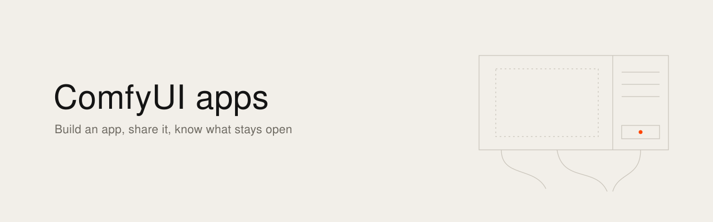

[English](README.md) · [Français](README.fr.md)

<picture><source media="(prefers-color-scheme: dark)" srcset="banner.svg"></picture>

# ComfyUI apps: build them, share them

I tried ComfyUI's App mode on my RTX 5090 on 7 November 2026, with ComfyUI 0.42 and frontend 1.57.1. The graph disappears, the inputs I chose are on the right, the output is in the centre, and the image came out in 17 seconds. So the next question was very simple: how do I give this to someone else? The official blog says share links work on Cloud and Local. The official docs say Cloud only. I'm a filmmaker, I read the code to know which one is right, and this note is what I found. Every claim has its URL, so you can check.

## The short version

- App mode changes the screen. It adds no login, no users and no permissions. Anyone who can reach your ComfyUI can run any workflow on it, app or no app.
- On a local install there is no Share button. You share a file, and the other person needs ComfyUI, a GPU, the models and the custom nodes.
- The link that needs no install exists on Comfy Cloud only.
- Friends with a GPU: send the file. Friends without one: Tailscale, and only people you'd give an account on your machine. A film team: a private server with a token in front. The public: a hosted endpoint behind your own site, never your own ComfyUI.

## What App mode is

[The announcement](https://blog.comfy.org/p/from-workflow-to-app-introducing) (10 March 2026) describes it as a new way to view and run any workflow: you pick which node inputs and outputs become the app. It runs "on the same ComfyUI instance, against the same backend, using the same queue". The workflow stays the same. Only the screen changes.

The app is not a separate format. It's your workflow with two extra fields: [`extra.linearMode`](https://github.com/Comfy-Org/ComfyUI_frontend/blob/v1.57.1/src/platform/workflow/management/stores/comfyWorkflow.ts) says if it opens as an app, and [`extra.linearData`](https://github.com/Comfy-Org/ComfyUI_frontend/blob/v1.57.1/src/stores/appModeStore.ts) lists the inputs and outputs.

## Versions

[The docs](https://docs.comfy.org/interface/app-mode) say App mode is officially supported from frontend 1.41.13. Earlier versions are an early test phase.

Read your frontend version in the interface instead of guessing it from the ComfyUI version. [ComfyUI 0.42.1 pins frontend 1.55.18](https://github.com/Comfy-Org/ComfyUI/blob/v0.42.1/requirements.txt), [0.43.0 pins 1.57.4](https://github.com/Comfy-Org/ComfyUI/blob/v0.43.0/requirements.txt) and [0.44.0 pins 1.57.6](https://github.com/Comfy-Org/ComfyUI/blob/v0.44.0/requirements.txt).

## Build an app, step by step

These steps follow [the docs](https://docs.comfy.org/interface/app-mode).

1. Open a workflow that already runs. Use the dropdown at the top left, or the breadcrumb, and choose "Enter app mode". A workflow with no app yet opens the builder.
2. **Inputs.** Click the highlighted nodes on the canvas to make them inputs: an image upload, a prompt, a model choice. They appear in the right sidebar.
3. **Outputs.** Choose the output nodes to show, such as Preview or Save Image.
4. **Preview.** Check the layout: inputs on the right, outputs in the canvas. Back lets you change things.
5. **Default view.** Choose if the workflow opens as an app or as a node graph, then Apply, then View app.
6. Save with Ctrl+S, or Cmd+S on a Mac. From the builder, the file gets the suffix [`.app.json`](https://github.com/Comfy-Org/ComfyUI_frontend/blob/v1.57.1/packages/shared-frontend-utils/src/formatUtil.ts).

Three things the test taught me:

- The Apps panel only lists `.app.json` files. My first save, as `.json`, did not show up there.
- The shortcut to switch from graph to app is Option+M on a Mac, Alt+M elsewhere ([command `Comfy.ToggleLinear`](https://github.com/Comfy-Org/ComfyUI_frontend/blob/v1.57.1/src/platform/keybindings/defaults.ts)). It helps when an extension bar covers the toggle button, which happened to me.
- A file opens directly as an app when `extra.linearMode` is `true`.

The docs also say the layout adapts to phones and narrow screens, with tabs for inputs, outputs and assets.

## Sharing: file, link, endpoint

People mix up three different things.

**The file.** This is the local way. The app itself says it: ["Export it from the tab menu and when others open it, they'll see App Mode."](https://github.com/Comfy-Org/ComfyUI_frontend/blob/v1.57.1/src/locales/en/main.json) Right-click the tab, Export. The file carries your field values, so your default prompts and the file names of your models. It carries no weights and no custom nodes, so send a list with it. Use the normal Export: [Export (API) writes `p.output`](https://github.com/Comfy-Org/ComfyUI_frontend/blob/v1.57.1/src/platform/workflow/core/services/workflowService.ts), and the app fields live in `p.workflow`.

**The link.** [The docs](https://docs.comfy.org/interface/app-mode) say: "Share links are only supported on Comfy Cloud." [The blog](https://blog.comfy.org/p/from-workflow-to-app-introducing) says URL sharing is available on Cloud and Local. The code agrees with the docs. In frontend 1.57.1 [the menu entry](https://github.com/Comfy-Org/ComfyUI_frontend/blob/v1.57.1/src/composables/useWorkflowActionsMenu.ts) has `visible: isCloud` and [the top bar button](https://github.com/Comfy-Org/ComfyUI_frontend/blob/v1.57.1/src/components/TopMenuSection.vue) has `v-if="isCloud"`. [`isCloud`](https://github.com/Comfy-Org/ComfyUI_frontend/blob/v1.57.1/src/platform/distribution/types.ts) is fixed when the frontend is built. [A commit of 7 October 2026](https://github.com/Comfy-Org/ComfyUI_frontend/commit/c64072bb6) says it: "the share UI is now gated on `isCloud` only".

The docs say the full configuration is in the link. In the code the link is [`?share=<id>`](https://github.com/Comfy-Org/ComfyUI_frontend/blob/v1.57.1/src/platform/workflow/sharing/services/workflowShareService.ts), so a published copy lives on Comfy's servers. The dialog warns you: ["you will share these media items along with your workflow"](https://github.com/Comfy-Org/ComfyUI_frontend/blob/v1.57.1/src/locales/en/main.json).

**The endpoint.** "Deploy to Comfy API" is in the tab menu, also on a local install. [The docs](https://docs.comfy.org/development/deploy/overview) say the card sends you to platform.comfy.org. There, [a Build pins the ComfyUI version, the nodes, the models and the Python dependencies](https://blog.comfy.org/p/comfy-api-is-live-deploy-comfyui), and you deploy it as an autoscaling endpoint. You then write your own front, or use someone else's.

## Which one for who

**Friends.** If they have a GPU, send the file and the list of models and nodes. If they don't, you can [share your machine with Tailscale](https://tailscale.com/docs/features/sharing): they see that one machine and nothing else on your network, and they need a Tailscale account. Keep ComfyUI on `127.0.0.1` and put [Tailscale Serve](https://tailscale.com/docs/features/tailscale-serve) in front. I'd only do it for people I'd give an account on the machine, for the reasons in the security section. For friends you trust less, [SwarmUI](https://github.com/mcmonkeyprojects/SwarmUI/blob/master/docs/Sharing%20Your%20Swarm.md) has real accounts and hides raw workflows from default users. It's a different interface from App mode, and its author validates it for "Friends and Family" only.

**A film team.** For material that stays private, I think the setup is one dedicated machine on a private network, ComfyUI on `127.0.0.1`, [comfy-api-proxy](https://docs.comfy.org/development/comfyui-server/api-proxy.md) with a token in front, and the app files in a private repository with their list of models. Tailscale's free plan is [for non-commercial use](https://tailscale.com/pricing), so a production needs a paid plan. You also have one queue: people wait for each other, and [`/interrupt` has no identity check](https://github.com/Comfy-Org/ComfyUI/blob/v0.44.0/server.py). I haven't run this setup with a team yet. If the material is not sensitive, [Comfy Cloud Team](https://comfy.org/pricing) has shared credits and roles.

**The public.** Never your own ComfyUI. Use a hosted endpoint behind your own site, and your site holds the accounts, the quotas and the spending limit. At $3.49 per hour one GPU minute costs about $0.06, before cold starts and storage. Comfy [suspended new free accounts in May 2026](https://x.com/ComfyUI/status/2053913932738507171) after abuse on expensive video models, so this risk is real for them too. Check the licence of each model: [MiniMax H3 run locally for commercial use starts at $5,000 a month](https://comfy.org/pricing).

## The options, with costs

Read on 7 November 2026. Prices move.

| Option | Cost | Licence | What leaves your machine |
|---|---|---|---|
| App file | Free | [ComfyUI, GPL-3.0](https://github.com/Comfy-Org/ComfyUI) | The file, to who you send it |
| [Comfy Cloud link](https://docs.comfy.org/interface/app-mode) | [From $20 a month, Team from $200](https://comfy.org/pricing) | Service | Workflow and media |
| [ComfyHub](https://comfy.org/hub/apps/) | No price found | Service | Everything, in public. [Access was selective in March](https://www.reddit.com/r/comfyui/comments/1rq3o5u/comfyui_launches_app_mode_and_comfyhub) |
| [Comfy API](https://comfy.org/platform/comfy-api.md) | Paid plan, plus $3.49/h on RTX PRO 6000, $0.20/GB/month | Service | Workflow, nodes, models, then your users' inputs and outputs |
| [ViewComfy](https://www.viewcomfy.com/pricing) | $0 plus compute, Team $30, Studio $200 | [AGPL-3.0 code](https://github.com/ViewComfy/ViewComfy) | On their cloud, everything. Self-hosted, it depends on your server |
| [ComfyDeploy](https://www.comfydeploy.com/comfyui-playground) | Not verified | [AGPL-3.0 code](https://github.com/BennyKok/comfyui-deploy) | On their cloud, everything |
| [RunComfy](https://www.runcomfy.com/) | Not verified | Service | Workflow, nodes, referenced models |
| [SwarmUI](https://swarmui.net/) | Free | MIT | Nothing |
| [ComfyUI with Tailscale](https://tailscale.com/pricing) | Free up to 6 users, non-commercial. Standard $8 per user per month | | Connection metadata |

[Comfy Registry](https://support.comfy.org/articles/1674221690-comfy-apis-an-overview) publishes custom nodes. It doesn't publish apps.

I looked for how studios share apps internally, and I found no first-hand account. What exists comes from vendors: [Silverside serving clients through Comfy API](https://blog.comfy.org/p/comfy-api-is-live-deploy-comfyui), quoted by Comfy, and [Comfy Enterprise](https://comfy.org/enterprise). If you do this in a studio, I'd like to know how.

## Security

**ComfyUI has no authentication.** [The docs](https://docs.comfy.org/development/deploy/self-hosting.md): "The ComfyUI server has no authentication by default." [The security policy](https://github.com/Comfy-Org/ComfyUI/blob/master/SECURITY.md): "Anyone with access to the ComfyUI URL is trusted". It also puts anything that needs `--listen` out of scope: "the user has chosen to expose it and is responsible for securing that deployment".

**App mode is no barrier.** The app only hides the graph. The server behind it [accepts the same requests](https://github.com/Comfy-Org/ComfyUI/blob/v0.44.0/server.py), and `/history`, `/queue` and `/view` are open to anyone who reaches it.

**`--multi-user` is no login.** [The docs](https://docs.comfy.org/development/comfyui-server/startup-flags.md) say it enables per-user storage. [The user comes from a `comfy-user` header](https://github.com/Comfy-Org/ComfyUI/blob/v0.44.0/app/user_manager.py) that the client sends.

**Never expose ComfyUI to the public internet.** This has been happening for real. [Censys](https://censys.com/blog/comfyui-servers-cryptomining-proxy-botnet) reported more than 1,000 exposed instances in April 2026, and a scanner installing malicious nodes through ComfyUI-Manager to run miners and a proxy botnet. It stays through a poisoned startup workflow, so a reboot doesn't clean it. [An issue on ComfyUI-Manager](https://github.com/Comfy-Org/ComfyUI-Manager/issues/3440) describes the same path. That excludes port forwarding and [Tailscale Funnel](https://tailscale.com/docs/features/tailscale-serve), which is the public version of Serve. Custom nodes are [arbitrary Python code](https://github.com/Comfy-Org/ComfyUI/blob/master/SECURITY.md), so review what you install.

**CORS: exact origin only, and know what the flag removes.** You need CORS when a web page on another address calls ComfyUI. [`--enable-cors-header` with no value means `*`](https://github.com/Comfy-Org/ComfyUI/blob/v0.44.0/comfy/cli_args.py), so always give the exact origin. In [`server.py`](https://github.com/Comfy-Org/ComfyUI/blob/v0.44.0/server.py) the flag also replaces the origin filter that refuses cross-site requests. `/prompt` reads the body with `request.json()` and doesn't check the content type. From reading the code, and I haven't tested it, a page open on a machine that can reach the server could still send a job, even if the browser hides the answer. [comfy-api-proxy](https://github.com/Comfy-Org/comfy-api-proxy/blob/main/docs/browser-access.md) is the cleaner way: it keeps the origin check, refuses `*`, and [won't bind outside loopback without a token](https://github.com/Comfy-Org/comfy-api-proxy).

**Your images carry your workflow.** ComfyUI saves it inside the files it makes. [`--disable-metadata`](https://docs.comfy.org/interface/settings/server-config) turns that off. Think about it before an image leaves the team.

**Desktop is not a server.** [The docs](https://docs.comfy.org/interface/settings/server-config): "it is not suitable for use as a server". For serving, they point to a manual install.

## What I still have to check

- Opening an exported app on a second machine. I read that it works, I haven't done it.
- The exact file name of an export, `.json` or `.app.json`.
- How frontend 1.57.1 ended up on my ComfyUI 0.42, since 0.42 pins another version.
- Tailscale Serve in front of ComfyUI, with the origin filter on.
- The `text/plain` request with the CORS flag on.
- Who pays for the compute on a Cloud link, the author or the person who opens it, and if that person needs an account.
- Today's access rules for publishing on ComfyHub.
- RunComfy and ComfyDeploy prices. Their pricing pages gave me nothing readable (one is a 404 today).
- Everything about share links comes from reading frontend 1.57.1, without a Cloud account. This moves fast, so check your own version.

---

State verified on 7 November 2026.

Ismaël Joffroy Chandoutis, 2026. Texts under a [CC BY-SA 4.0](LICENSE) license.

By [Ismaël Joffroy Chandoutis](https://ismaeljoffroychandoutis.com).
